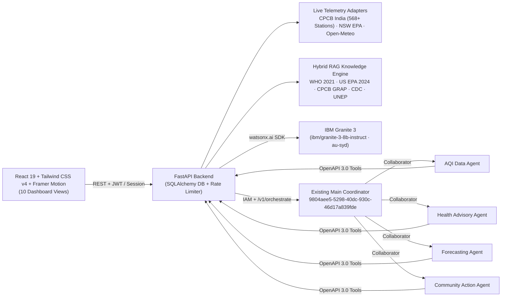

# Daily Air Quality Action Agent (AirGuard AI)

> An AI-powered environmental intelligence and preventive daily action platform built with **React**, **FastAPI**, **IBM Granite (watsonx.ai)**, **IBM watsonx Orchestrate**, and **IBM Cloud** deployment readiness for **Problem Statement No. 15: "The Daily Air Quality Action Agent"**.

---

## 1. Project Overview

**AirGuard AI** transforms live air quality telemetry and meteorological forecasts into clear, verifiable insights, personalized daily health precautions, early pollution spike alerts, and collective community mitigation actions. Every measurement preserves strict source attribution—clearly separating official government station telemetry, modelled atmospheric estimates, and probabilistic forecasts without ever fabricating live pollutant readings.

---

## 2. Problem Statement

**Problem Statement No. 15 — The Daily Air Quality Action Agent:**
Citizens, families, outdoor workers, and vulnerable groups (children, older adults, and individuals with respiratory or cardiovascular sensitivities) often see raw AQI numbers without understanding what pollutants are driving risk, how air quality will evolve over the next 48 hours, what non-diagnostic precautions to take indoors or outdoors, or how local communities and municipal clean-air policies reduce exposure.

---

## 3. Project Objectives

1. **Trusted Real-Time Telemetry:** Retrieve, validate, and attribute real-time AQI and pollutants (`PM2.5`, `PM10`, `CO`, `NO2`, `SO2`, `O3`, `NH3`, and explicit `Pb` availability status) from official government and atmospheric feeds.
2. **Multi-Agent Coordination:** Connect an existing IBM watsonx Orchestrate main coordinator agent (`9804aee5-5298-40dc-930c-46d17a839fde`) to four specialized collaborator agents (**AQI Data Agent**, **Health Advisory Agent**, **Forecasting Agent**, and **Community Action Agent**).
3. **Grounded RAG + IBM Granite Reasoning:** Combine curated environmental health and policy guidelines (WHO 2021, US EPA 2024, India CPCB NAQI & GRAP, CDC, UNEP) with IBM Granite (`ibm/granite-3-8b-instruct`) reasoning and source citations.
4. **Actionable User Experience:** Deliver a responsive, Apple-inspired 10-page environmental intelligence dashboard with privacy-conscious consent and removable health preferences.

---

## 4. Key Features

- **10 Complete Interactive Views:**
  1. **Dashboard:** Executive bento grid with live AQI radial gauge, personalized daily summary, pollutant grid, station map preview, 48h forecast snapshot, active alerts, quick AI ask bar, and live multi-agent trace.
  2. **Live AQI Monitoring:** Full 8-species breakdown, WHO 2021 24-hour guideline comparison, meteorological dispersion telemetry (wind, humidity, temperature, pressure, UV, dust), and data validation audit.
  3. **Air Pollution Map:** Interactive Leaflet station & hotspot map (`All Stations` vs `Elevated Hotspots` filter) plus sortable station table.
  4. **Historical AQI Analytics:** Interactive multi-metric 48-hour curves (`US AQI`, `PM2.5`, `PM10`, `O3`, `NO2`, `SO2`), WHO/EPA reference thresholds, exceedance statistics, and CSV export.
  5. **Pollution Forecasts:** 48-hour predictive trajectory with explicit `uncertainty_low`–`uncertainty_high` bounds, confidence percentages, unhealthy window alerts, and preventive timing advice.
  6. **Personalized Health Advisory:** Editable and one-click removable exposure profile (age group, outdoor activity intensity, optional health considerations), mask/HEPA guidance, 6-group vulnerability matrix, and non-diagnostic safety disclaimer.
  7. **Predictive Alerts & Notifications:** Database-persisted threshold and forecast warnings with severity filters, read states, and dismissal.
  8. **Community Action & Awareness:** Database-backed community action pledges (`carpooling`, `transit`, `zero burning`, `urban tree belts`, `clean-air hubs`), citizen pollution report submissions, and policy summaries (CPCB GRAP, US EPA, WHO).
  9. **AI Air Quality Chat Assistant:** Conversational assistant routed via the main watsonx Orchestrate coordinator with session persistence, starter prompts, agent execution traces, and RAG citations.
  10. **Settings & Diagnostics:** Optional JWT sign-in/register, location permission revocation, AQI scale selection, System/Light/Dark appearance toggle, and live IBM Granite / watsonx Orchestrate connectivity inspector.
- **Strict Anti-Fabrication Policy:** Explicitly rejects WAQI's `token=demo` (which returns Shanghai for any city), marks unmonitored pollutants (`Pb`) as unavailable rather than synthesizing defaults, and returns structured `404`/`503` responses if upstream sources fail.

---

## 5. Multi-Agent Architecture



| Agent | Role & Key Responsibilities | Primary Outputs |
|---|---|---|
| **Main Coordinator** (`9804aee5-5298-40dc-930c-46d17a839fde`) | Existing IBM watsonx Orchestrate coordinator routing requests across all 4 specialist agents and synthesizing unified grounded responses. | Combined answer, execution trace, citations, timestamp |
| **AQI Data Agent** | Resolves locations, fetches CPCB/NSW/Open-Meteo (plus optional WAQI/OpenAQ/AirNow), validates ranges/freshness, and detects hotspots. | Validated `LiveAQIResponse`, `HotspotStation[]`, `ValidationReport` |
| **Health Advisory Agent** | Evaluates personal vulnerability across age, activity, and optional health considerations using IBM Granite + WHO/EPA/CDC RAG. | Non-diagnostic precautions, N95/HEPA guidance, 6-group matrix |
| **Forecasting Agent** | Analyzes 48h history + 72h forecast + wind dispersion, quantifies uncertainty bands, and detects unhealthy windows. | `ForecastPoint[]` with uncertainty bounds & early warnings |
| **Community Action Agent** | Infers dominant local emission sources, tracks persisted community pledges/reports, and summarizes government policies. | Campaigns, pledge counts, citizen reports, GRAP/EPA/WHO summaries |

---

## 6. Technology Stack

- **IBM Ecosystem:**
  - **IBM watsonx Orchestrate (`au-syd`):** Multi-agent coordinator (`9804aee5-5298-40dc-930c-46d17a839fde`), collaborator agent YAMLs (`orchestrate/agents/`), and OpenAPI 3.0 tool definitions (`orchestrate/openapi/airguard_tools.openapi.yaml`).
  - **IBM Granite (`ibm/granite-3-8b-instruct` & `ibm/slate-125m-english-rtrvr`):** Accessed securely on the backend via `ibm-watsonx-ai` SDK against `https://au-syd.ml.cloud.ibm.com`.
  - **IBM Cloud Readiness:** Containerized Dockerfiles (`deploy/Dockerfile.backend`, `deploy/Dockerfile.frontend`), Code Engine manifest (`deploy/code-engine.yaml`), and PostgreSQL connection support (`DATABASE_URL`).
  - **IBM Bob / University Engagement Alignment:** Structured multi-agent architecture, documentation, and deployment workflow tailored for IBM Cloud & watsonx submission.
- **Frontend:** React 19, TypeScript, Vite 8, Tailwind CSS v4 (`@tailwindcss/vite`), Framer Motion (`framer-motion`), Lucide Icons (`lucide-react`), Recharts v3, Leaflet + `react-leaflet`, Zustand v5.
- **Backend & Persistence:** Python 3.12, FastAPI, Uvicorn, Pydantic v2 (`pydantic-settings`), SQLAlchemy 2 (`SQLite` local / `PostgreSQL` cloud), `httpx`, `pyjwt`, `pytest`.
- **Live Environmental APIs:** India CPCB CAAQMS RSS Feed (`airquality.cpcb.gov.in`), NSW Government EPA (`data.airquality.nsw.gov.au`), Open-Meteo Air Quality, Weather & Geocoding APIs, plus optional keyed WAQI / OpenAQ v3 / AirNow adapters.

---

## 7. System Workflow

1. **Location Resolution & Telemetry Fetch:** User selects a city, searches via geocoding, or grants explicit location consent; `AQIDataAgent` retrieves station + modelled concentrations and meteorological telemetry.
2. **Parallel Specialist Reasoning:** `HealthAdvisoryAgent`, `ForecastingAgent`, and `CommunityActionAgent` execute concurrently using validated telemetry, SQL database history/pledges, RAG knowledge chunks, and IBM Granite.
3. **Database Sync & Alert Generation:** Snapshots, predictive spike alerts, and user preferences persist in SQLAlchemy storage.
4. **Unified Response & Interactive Exploration:** Dashboard pages and the AI Chat Assistant render live visualizations, agent execution traces, and clickable RAG source citations.

---

## 8. Repository Structure

```text
.
├── backend/                     # Modular FastAPI server, SQLAlchemy DB, RAG, Granite & tests
│   ├── app/
│   │   ├── agents/              # 4 specialist agents + Main Coordinator
│   │   ├── api/                 # REST routers + OpenAPI Orchestrate tool endpoints
│   │   ├── core/                # Settings, DB engine, PBKDF2/JWT security, rate limiter
│   │   ├── knowledge/           # Curated WHO, EPA, CPCB/GRAP, CDC, UNEP RAG docs
│   │   ├── models/              # SQLAlchemy ORM models
│   │   ├── schemas/             # Strict Pydantic v2 contracts
│   │   └── services/            # Live AQI sources, RAG engine, Granite, Orchestrate client
│   ├── tests/                   # Pytest integration suite
│   ├── .env.example             # Safe placeholder environment template
│   ├── pyproject.toml
│   └── requirements.txt
├── orchestrate/                 # IBM watsonx Orchestrate ADK configs & sync tooling
│   ├── agents/                  # 4 collaborator agent YAMLs + coordinator config JSON
│   ├── openapi/                 # OpenAPI 3.0 specification for Orchestrate tools
│   ├── scripts/sync_orchestrate.py
│   └── README_ORCHESTRATE.md
├── deploy/                      # IBM Cloud Code Engine & Docker/Nginx deployment configs
├── docs/                        # Audit report, REST API docs, deployment checklist
├── src/                         # React + TypeScript + Tailwind + Framer Motion frontend
│   ├── components/              # AppShell, AQIGaugeCard, PollutionMapWidget, CitationsDrawer
│   ├── pages/                   # All 10 interactive application pages
│   ├── services/                # Typed backend REST client
│   ├── store/                   # Zustand global state & theme/consent actions
│   └── types/                   # TypeScript interfaces matching FastAPI schemas
├── index.html
├── package.json
└── vite.config.ts
```

---

## 9. Installation & Setup

### Prerequisites
- **Node.js** 20+ and **npm**
- **Python** 3.11–3.13 (tested with Python 3.12) and `pip` / `uv`

### Backend Setup
```bash
cd backend
cp .env.example .env
python3 -m venv .venv
source .venv/bin/activate
pip install -r requirements.txt
```

### Frontend Setup
```bash
npm install
```

---

## 10. Environment Variable Configuration

Configure `backend/.env` using placeholders from `backend/.env.example` (never commit `.env`):

| Variable | Required | Description |
|---|---|---|
| `APP_SECRET_KEY` | Yes (Prod) | Random secret used to sign JWT session tokens |
| `DATABASE_URL` | Optional | Defaults to local SQLite; set `postgresql+psycopg://...` for IBM Cloud PostgreSQL |
| `CORS_ORIGINS` | Optional | Allowed frontend origins (default `http://localhost:5173,http://127.0.0.1:5173`) |
| `IBM_CLOUD_API_KEY` / `WATSONX_AI_API_KEY` | For IBM Granite | IBM Cloud IAM API key for `au-syd.ml.cloud.ibm.com` |
| `WATSONX_PROJECT_ID` | For IBM Granite | watsonx.ai project ID in `au-syd` |
| `WATSONX_ORCHESTRATE_INSTANCE_URL` | For Live Orchestrate | Service Instance URL (`https://api.au-syd.watson-orchestrate.cloud.ibm.com/instances/<TENANT_ID>`) |
| `WATSONX_ORCHESTRATE_API_KEY` | For Live Orchestrate | IAM API key for watsonx Orchestrate |
| `WATSONX_ORCHESTRATE_AGENT_ID` | Pre-set | Existing main agent ID: `9804aee5-5298-40dc-930c-46d17a839fde` |
| `WAQI_API_TOKEN` / `OPENAQ_API_KEY` / `AIRNOW_API_KEY` | Optional | Extra station feeds (note: CPCB India, NSW EPA, and Open-Meteo require zero keys) |

> **IBM watsonx Orchestrate Setup:** Follow [orchestrate/README_ORCHESTRATE.md](orchestrate/README_ORCHESTRATE.md) to deploy `backend/` to IBM Cloud Code Engine, run `orchestrate/scripts/sync_orchestrate.py`, and attach the 4 specialist collaborators to your existing agent (`9804aee5-5298-40dc-930c-46d17a839fde`).

---

## 11. How to Run & Verify

### Start Both Servers Locally
Terminal 1 (FastAPI Backend on port `8000`):
```bash
cd backend
source .venv/bin/activate
uvicorn app.main:app --reload --port 8000
```

Terminal 2 (React Frontend on port `5173`, proxies `/api` to `127.0.0.1:8000`):
```bash
npm run dev
```
Open `http://localhost:5173/` in your browser (Swagger API docs at `http://127.0.0.1:8000/docs`).

### Verification Commands
```bash
# Backend unit & live integration tests
cd backend && .venv/bin/pytest -v

# Frontend lint & strict TypeScript production build
npm run lint && npm run build
```

---

## 12. UI Modules & Screenshots Overview

Run the app locally at `http://localhost:5173/` to inspect all 10 responsive views across desktop and mobile (`System` / `Light` / `Dark` glassmorphism themes):
- **Dashboard (`src/pages/DashboardPage.tsx`):** Bento overview with animated AQI gauge, health checklist, 8-pollutant bar, Leaflet map, 48h forecast summary, alerts, and AI quick-ask.
- **Live Monitoring & Pollution Map (`LiveMonitoringPage.tsx`, `PollutionMapPage.tsx`):** Station vs modelled provenance badges, validation checks, meteorology, and interactive station markers.
- **Analytics & Forecasts (`HistoricalAnalyticsPage.tsx`, `ForecastPage.tsx`):** Recharts time-series, WHO/EPA thresholds, CSV export, and forecast uncertainty bounds.
- **Health, Alerts, Community & Assistant (`HealthAdvisoryPage.tsx`, `AlertsPage.tsx`, `CommunityPage.tsx`, `AssistantPage.tsx`, `SettingsPage.tsx`):** Removable health profile, persisted alerts, citizen reporting, RAG citations, and IBM integration diagnostics.

---

## 13. Future Scope

- Automated push notifications (Web Push / email digests) for morning school and commute air quality briefings.
- Direct integration of regional EPA IoT sensor networks (OpenAQ v3 and US EPA AirNow streaming subscriptions).
- Continuous IBM watsonx.governance evaluation for Granite advisory grounding and latency telemetry.
- Multi-language localization for regional public health advisories.

---

## 14. Contributors

- **Hardik Purswani** — Project Author, Architecture, Full-Stack & IBM watsonx Integration (`hardikpurswani-alt`)

---

## Additional Documentation
- [Audit & Architecture Blueprint](docs/AUDIT_AND_ARCHITECTURE.md)
- [REST API Reference](docs/API_DOCUMENTATION.md)
- [watsonx Orchestrate Integration Guide](orchestrate/README_ORCHESTRATE.md)
- [IBM Cloud Deployment Checklist](docs/DEPLOYMENT_CHECKLIST.md)
