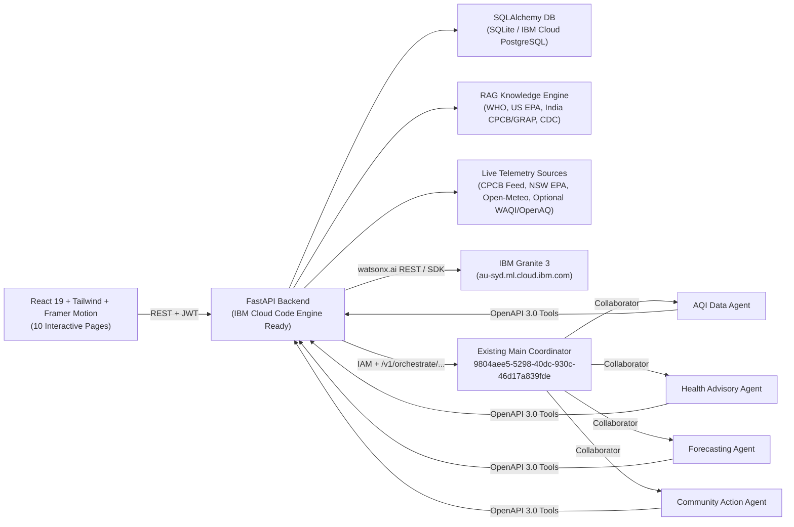

# AirGuard AI — Complete Project Audit & Architecture Plan
*(Problem Statement No. 15: "The Daily Air Quality Action Agent")*

---

## 1. Baseline Repository Audit (Step 1)

Baseline git snapshot committed at `9821f6d` (`Baseline audit snapshot before AirGuard AI rebuild`).

### 1.1 Existing Codebase Findings
| Area | Finding | Risk / Impact | Remediation |
|---|---|---|---|
| **Frontend Entry (`src/App.tsx`, `src/App.css`)** | Still the stock Vite counter template; none of the 7 UI components or `useAQStore` were mounted. | High — application did not render the AirGuard dashboard at all. | Replace with full 10-page responsive environmental intelligence shell & bento workspace. |
| **TypeScript & Lint Baseline** | `npm run build` failed with **11 TypeScript errors** across 5 files (`orchestrator.ts`, `AQIGauge.tsx`, `ForecastPanel.tsx`, `HistoricalChart.tsx`, `PollutionMap.tsx`); `npm run lint` reported 11 unused-symbol warnings. | High — project did not compile. | Clean strict TypeScript typing across all modules; fix Recharts v3 formatter types. |
| **Stack Gaps** | `tailwindcss`, `framer-motion`, and `lucide-react` were not installed; components used inline JS style objects and hardcoded dark CSS. | Medium — lacked Tailwind design tokens, Framer Motion micro-interactions, and Lucide iconography. | Install Tailwind CSS v4 (`@tailwindcss/vite`), Framer Motion, and Lucide Icons; add accessible system/light/dark theming. |
| **Data Integrity (`src/agents/aqiDataAgent.ts`)** | Used `WAQI_TOKEN = 'demo'` (which always returns Shanghai station `idx: 1437` regardless of queried city!), labeled Open-Meteo `CO`/`O3`/`NO2`/`SO2` as `ppb`/`ppm` when Open-Meteo outputs `µg/m³`, synthesized random `trend`/`changePercent` via `Math.random()`, and fell back to `generateSimulatedReading` / `generateSimulatedStations`. Missing `NH3` and `Pb`. | Critical — violated truthfulness and produced wrong city data. | Move all data collection to FastAPI backend; reject `demo` WAQI token; integrate real CPCB India XML feed (568+ stations), NSW EPA, and Open-Meteo CAMS + meteorology; mark `Pb` as unmonitored (`null`) when unavailable; zero fake AQI values. |
| **Forecast & Community (`forecastingAgent.ts`, `communityActionAgent.ts`)** | Fabricated forecast points with `Math.random()`, fabricated `reportCount` with `Math.random()`, and hardcoded fake participant counts. | High — undermined scientific credibility. | Compute real uncertainty bands from Open-Meteo hourly/forecast ensemble variance; persist genuine community pledges & reports in SQL database. |
| **IBM Granite Security (`src/services/graniteClient.ts`)** | Exposed `VITE_WATSONX_API_KEY` in client bundle, pointed to `us-south` instead of `au-syd`, used deprecated `ibm/granite-13b-instruct-v2`, expected OpenAI `choices` schema against `/ml/v1/text/generation`, and silently returned canned fallback strings. | Critical — credential exposure + broken API contract. | Move all IBM Cloud IAM, watsonx.ai Granite (`ibm/granite-3-8b-instruct`), and RAG operations strictly to FastAPI backend. |
| **Backend, DB & watsonx Orchestrate** | Completely absent. Existing `au-syd` main agent (`9804aee5-5298-40dc-930c-46d17a839fde`) was not connected. | Critical — no persistence, auth, RAG, or Orchestrate coordination. | Build modular FastAPI + SQLAlchemy backend, RAG knowledge engine, and `orchestrate/` ADK collaborator + OpenAPI tool package. |

---

## 2. Target Architecture

### 2.1 Multi-Agent Responsibilities
1. **Main Coordinator (Existing Agent `9804aee5-5298-40dc-930c-46d17a839fde`)**: Routes user queries & daily briefing requests across the four specialist collaborators, synthesizes structured responses with citations, timestamps, and failure disclosures. Never duplicated.
2. **AQI Data Agent**: Resolves city/coordinates, ingests live CPCB/NSW/Open-Meteo (plus optional WAQI/OpenAQ/AirNow), validates ranges/freshness, separates `official_monitoring_station` vs `modelled_estimate`, and detects nearby station hotspots.
3. **Health Advisory Agent**: Stratifies risk by age group, activity intensity, and optional removable health considerations; outputs mask/HEPA/timing precautions backed by RAG (`WHO 2021`, `US EPA`, `CDC`) and IBM Granite reasoning without diagnosing conditions.
4. **Forecasting Agent**: Analyzes 48h history + 72h Open-Meteo forecast + meteorological drivers (wind, humidity, pressure), computes prediction uncertainty bands, detects unhealthy windows, and issues early preventive warnings.
5. **Community Action Agent**: Attributes dominant emission drivers, drives community pledges (carpooling, transit, waste reduction, urban plantation), and summarizes local/international policies (`CPCB GRAP`, `US EPA`, `WHO`) with RAG references.
